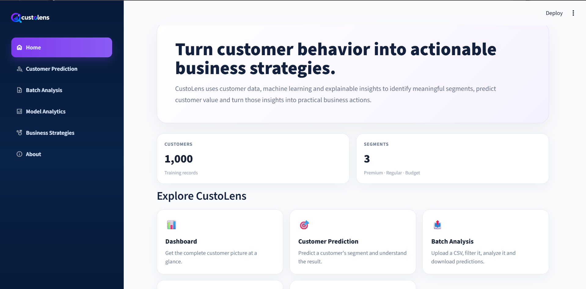
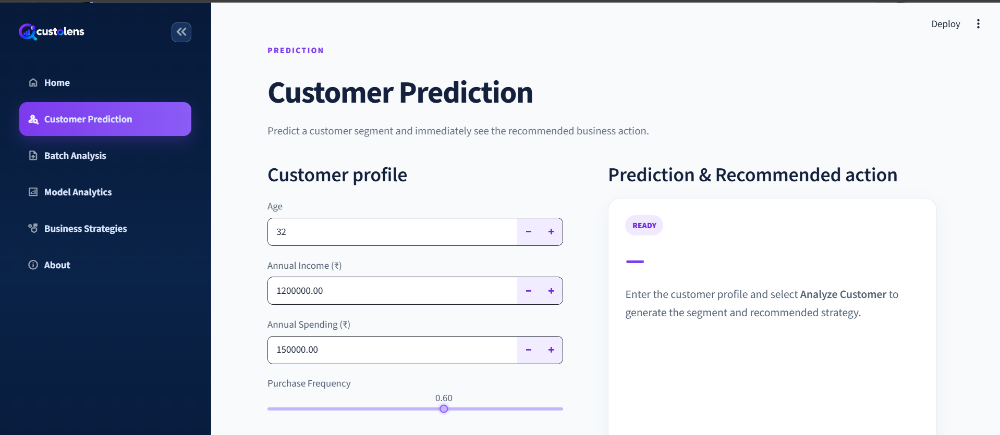
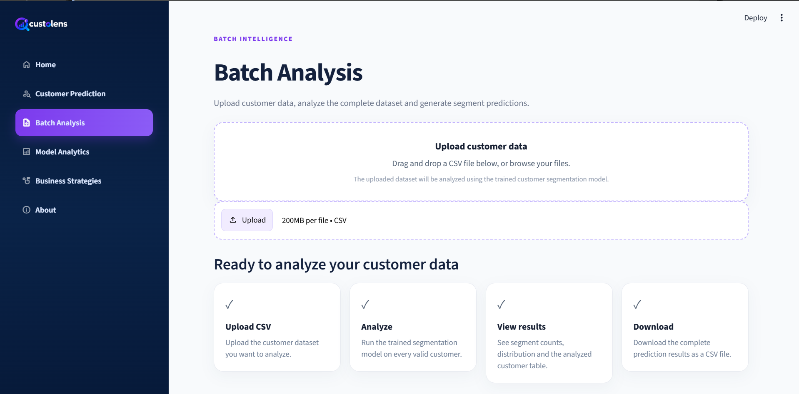
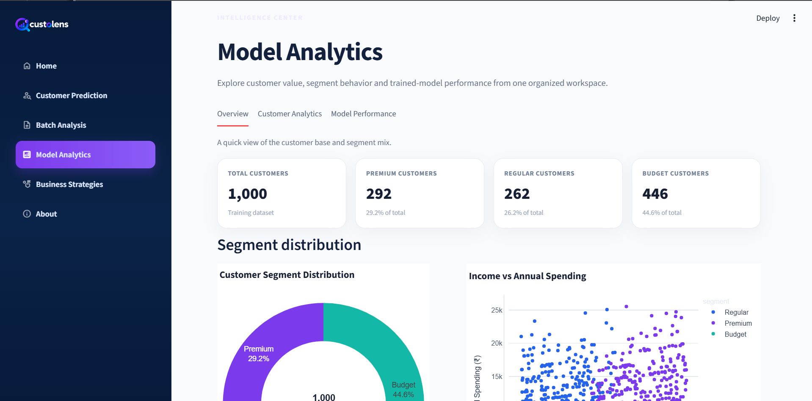
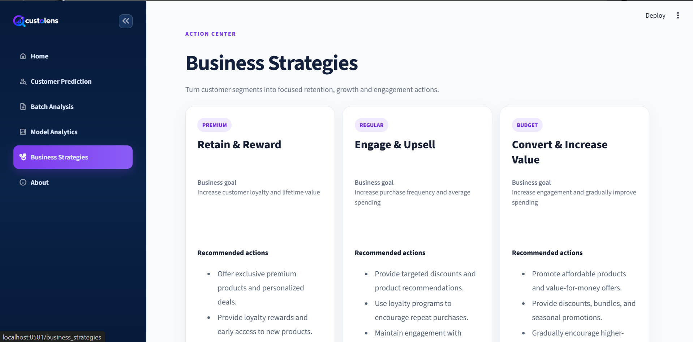

# CustoLens AI 🤖

## 📌 Description

CustoLens AI is an AI-powered customer intelligence platform built using Python and Streamlit that helps businesses analyze customer data, perform customer segmentation, predict customer groups, and generate data-driven business strategies.

## 🌐 Live Demo

Experience CustoLens AI:

[Launch CustoLens AI](https://custolens-ai.streamlit.app/)

[View Source Code](https://github.com/mohmmadkaif7/Custolens-ai)

## 🚀 Features

* Customer segmentation into Premium, Regular, and Budget categories
* Customer segment prediction using Random Forest
* Interactive customer analytics dashboard
* Batch customer analysis using CSV uploads
* Customer data validation and filtering
* Prediction confidence and explainability
* Business strategy recommendations
* Interactive charts and visualizations
* CSV export of analysis results
* Optional FastAPI backend integration

## 🛠️ Tech Stack

* Python
* Streamlit
* FastAPI
* Scikit-learn
* Pandas
* NumPy
* Joblib
* Pytest

## 📂 Functionalities Implemented

* Customer segmentation using machine learning
* Random Forest-based customer prediction
* Data preprocessing and validation
* Batch CSV processing
* Prediction probabilities and explainability
* Customer analytics and visualization
* Business recommendation generation
* REST API integration
* Automated testing using Pytest

## ▶️ How to Run

1. Clone the repository:

```bash
git clone <YOUR_GITHUB_REPOSITORY_URL>
cd Custolens-ai
```

2. Create a virtual environment:

```bash
python -m venv .venv
```

3. Activate the virtual environment:

**Windows:**
```powershell
.venv\Scripts\Activate.ps1
```

4. Install dependencies:

```bash
pip install -r requirements.txt
```

5. Run the application:

```bash
streamlit run app.py
```

6. Run the optional FastAPI backend:

```bash
uvicorn api:app --reload --port 8000
```

## 📷 Screenshots

### Home Page


### Customer Prediction


### Batch Analysis


### Analytics


### Business Strategies


## 🧪 Testing

Run automated tests using:

```bash
pytest -v
```

## 🌐 Future Improvements

* Cloud deployment
* Advanced customer behavior analysis
* Additional machine learning models
* Enhanced business intelligence and reporting
* Real-time customer analytics

## 👨‍💻 Author

**MOHAMMAD KAIF**
